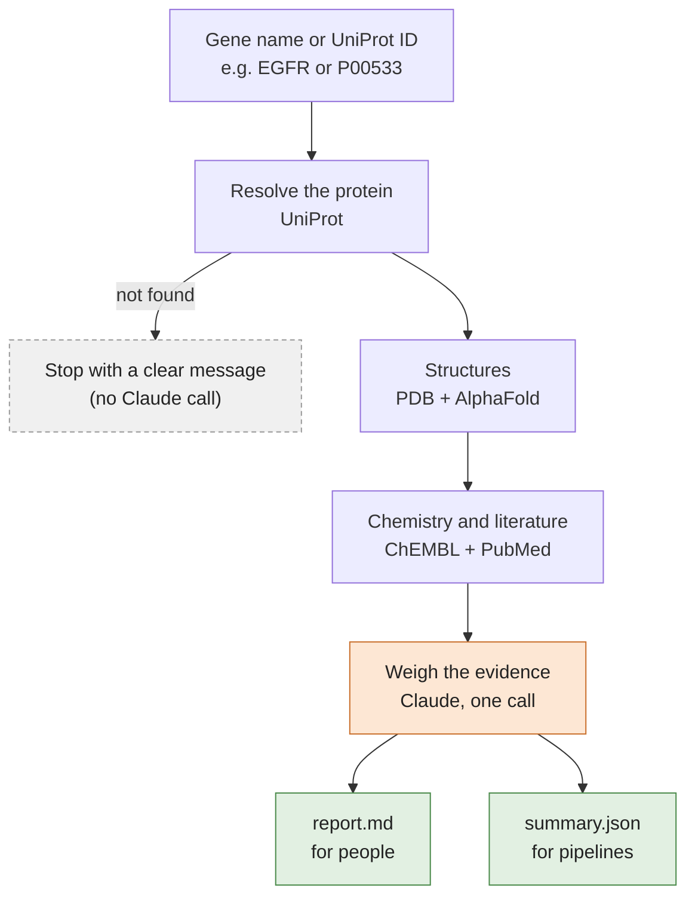
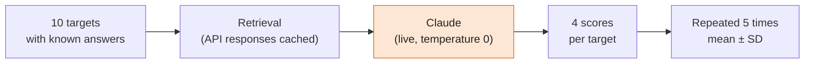

# Target Atlas

[](https://github.com/izgys/target-atlas/actions/workflows/ci.yml)
[](https://github.com/izgys/target-atlas/releases)

[](LICENSE)

**Evidence-graded druggability assessment for human protein targets.**

Give Target Atlas a gene name or a UniProt ID. It collects the evidence from five public databases, asks Claude to weigh it, and gives you a report with confidence levels, the reasoning behind them, and a list of what is still unknown.

```bash
target-atlas run TREM2
```

```text
TREM2 (Q9NZC2) · Homo sapiens
  Druggability             medium
  Structural confidence    high
  Chemical confidence      none
  Literature confidence    high
  Evidence                 15 PDB entries · 0 IC50 entries · 0 approved drugs · 844 papers

Evidence gaps
  • No approved drugs for TREM2 by any modality
  • Identity and chemical class of the 11 PDB-bound ligands not specified (may be peptides,
    lipids, or endogenous ligands rather than drug-like small molecules)
  • No data on intracellular domain druggability (DAP12 signalling interface)
  ...

Report: results/TREM2_Q9NZC2/report.md
Summary: results/TREM2_Q9NZC2/summary.json
```

TREM2 is a deliberately hard case: excellent structures, no chemistry. Its overall verdict switches between `medium` and `high` across repeated runs (see [How well does it work?](#how-well-does-it-work)).

## Why

Choosing a drug target is one of the most expensive decisions in drug discovery, and the evidence behind it is still mostly pulled together by hand: structures from one database, chemistry from another, papers from a third. That works for a famous target like EGFR. It gets slow for a new target, or for twenty candidates at once.

Target Atlas automates the gathering and the first read of that evidence, and keeps the reasoning visible. You can check every conclusion instead of trusting a single score.

## How it works



| Source | What Target Atlas takes from it |
|---|---|
| UniProt | Canonical ID, gene name, organism |
| PDB | Experimental structures, best resolution, how many have something bound |
| AlphaFold | How much of the predicted structure is confident (pLDDT) |
| ChEMBL | Number of IC50 measurements, median IC50, approved drugs |
| PubMed | How many papers have the gene in the title, and the most recent ones |

A few things worth knowing:

- **Each source is fetched on its own.** If one fails (ChEMBL has its bad days), the run carries on and the report says "retrieval failed" instead of pretending the data does not exist.
- **Only one step uses an LLM.** Everything else is plain code, so a run costs about $0.02 and every step can be tested on its own.
- **Confidence is scored per type of evidence.** Claude rates structural, chemical and literature evidence separately (`high`, `medium`, `low` or `none`) against thresholds written in the prompt, then combines them into an overall verdict.

## Quick start

You need an [Anthropic API key](https://console.anthropic.com/). After cloning, create a file called `.env` in the repository folder with one line, without quotes:

```text
ANTHROPIC_API_KEY=sk-ant-...
```

`.env` is ignored by git and never copied into the Docker image, so the key stays on your machine.

**Option 1: Docker** (no Python setup needed)

```bash
git clone https://github.com/izgys/target-atlas
cd target-atlas
# create .env as shown above, then:
docker build -t target-atlas .
docker run --rm --env-file .env -v "$(pwd)/results:/app/results" target-atlas run EGFR   # macOS/Linux
docker run --rm --env-file .env -v "%cd%/results:/app/results" target-atlas run EGFR     # Windows (cmd)
```

**Option 2: Python** with [uv](https://docs.astral.sh/uv/) (fetches Python 3.12 if you don't have it)

```bash
git clone https://github.com/izgys/target-atlas
cd target-atlas
# create .env as shown above, then:
uv sync
uv run target-atlas run EGFR
```

## Usage

The commands below are written as `target-atlas ...`. With uv, put `uv run` in front (or activate `.venv` first). With Docker, put them after `docker run ... target-atlas`.

```bash
target-atlas run EGFR                   # by gene name
target-atlas run P00533                 # or by UniProt ID
target-atlas run TREM2 --out reports    # choose the output folder
```

Each run writes two files to `results/<GENE>_<UNIPROT>/`: `report.md`, with the assessment, reasoning and evidence tables, and `summary.json`, the same content in machine-readable form. The exit code tells scripts what happened: `0` for a full report, `1` if the target could not be resolved, `2` if the Claude step failed (the report then still contains all retrieved evidence).

### Changing settings

Every setting lives in `configs/agents.yaml` and `configs/apis.yaml`. Edit the files, or change a value for a single run with `--set`:

```bash
target-atlas run EGFR --set apis.pdb.max_structures=50
target-atlas run EGFR --set agents.reasoning.temperature=1
```

| Setting | Default | What it changes |
|---|---|---|
| `agents.reasoning.model` | `claude-sonnet-4-6` | The Claude model used for the assessment |
| `agents.reasoning.temperature` | `0` | How much the reasoning step varies between runs |
| `apis.pdb.max_structures` | `20` | How many of the best-resolved structures are inspected in detail |
| `apis.pubmed.max_results` | `20` | How many recent papers are retrieved |

A misspelled setting is rejected with an error, so a typo cannot silently do nothing.

## How well does it work?

An evaluation harness runs the pipeline on ten targets whose answers were checked against the databases beforehand: six kinases (EGFR, ERBB2, BRAF, ABL1, BTK, JAK2), KRAS, two targets dominated by antibodies (CD274/PD-L1, IL6R) and one sparse target (TREM2). The scoring is plain code, so no LLM grades another LLM.



Because the database responses are cached, every repeat sees exactly the same evidence. Any difference between repeats comes from Claude.

| Metric | The question it answers |
|---|---|
| Identity | Did it find the right protein? |
| Fact recall | Did it retrieve the landmark structures, approved drugs and key papers we expected? |
| Citation validity | Does every PDB ID and PMID in the output exist and belong to this target? |
| Gap honesty | Do the confidence levels match the evidence? For example, no ChEMBL data must mean low chemical confidence, with the gap listed. |

**Results** (`claude-sonnet-4-6`, temperature 0, commit `3319341`, five repeats; full run in [`evals/results/2026-10-24_201154`](evals/results/2026-10-24_201154/results.md)):

| Target | Identity | Fact recall | PDB | Drugs | PMIDs | Citation validity | Gap honesty (mean ± SD) | Same verdict |
|---|---|---|---|---|---|---|---|---|
| EGFR | 1.00 | 0.36 | 0/5 | 4/4 | 0/2 | 1.00 | 1.00 ± 0.00 | 5/5 |
| ERBB2 | 1.00 | 0.75 | 2/3 | 4/4 | 0/1 | 1.00 | 1.00 ± 0.00 | 5/5 |
| BRAF | 1.00 | 0.38 | 0/3 | 3/3 | 0/2 | 1.00 | 1.00 ± 0.00 | 5/5 |
| KRAS | 1.00 | 0.29 | 0/3 | 2/2 | 0/2 | 1.00 | 1.00 ± 0.00 | 5/5 |
| ABL1 | 1.00 | 0.50 | 0/3 | 4/4 | 0/1 | 1.00 | 1.00 ± 0.00 | 5/5 |
| BTK | 1.00 | 0.62 | 2/3 | 3/3 | 0/2 | 1.00 | 1.00 ± 0.00 | 5/5 |
| JAK2 | 1.00 | 0.43 | 0/3 | 3/3 | 0/1 | 1.00 | 1.00 ± 0.00 | 5/5 |
| CD274 | 1.00 | 0.38 | 0/3 | 3/3 | 0/2 | 1.00 | 1.00 ± 0.00 | 5/5 |
| IL6R | 1.00 | 0.80 | 2/2 | 2/2 | 0/1 | 1.00 | 0.67 ± 0.00 | **4/5** |
| TREM2 | 1.00 | 0.60 | 3/3 | n/a | 0/2 | 1.00 | 0.88 ± 0.11 | **3/5** |
| **Mean** | **1.00** | **0.51** | | | | **1.00** | **0.95 ± 0.01** | **8/10** |

Identity, fact recall and citation validity only depend on the cached retrieval, so they were identical in all five repeats. *Same verdict* counts the repeats in which Claude gave the most common combination of its four verdicts.

What the numbers say:

- **The right protein and all approved drugs were found for every target** (28 of 28 drugs).
- **Low PDB and PMID recall is a design choice, not a bug.** The pipeline inspects the 20 best-resolved structures and the 20 newest papers, and landmark entries often fall outside that window: EGFR's erlotinib structure 1M17 ranks 191st of 393 by resolution.
- **Citation validity is mostly a plumbing check for now.** Claude did not write any PDB IDs or PMIDs of its own into these reports, so every citation came straight from a database.
- **Temperature 0 does not make Claude fully consistent.** TREM2 came out `high` in three runs and `medium` in two, and it fails the sparse-target check whenever it says `high`. IL6R fails the same check every time, because the scoring rules have no category for antibodies. This is why the table shows five runs and not one.

Run it yourself from the repository folder:

```bash
target-atlas eval                       # all ten targets
target-atlas eval -t EGFR -t TREM2      # a subset
target-atlas eval --repeats 5           # five full runs, reported as mean ± SD
```

Each run is saved to `evals/results/` and logged to a local [MLflow](https://mlflow.org/) store, where you can compare runs side by side:

```bash
mlflow ui --backend-store-uri sqlite:///mlruns/mlflow.db    # then open http://127.0.0.1:5000
```

[`examples/`](examples/) has complete reports for three contrasting targets: EGFR (rich evidence: 393 PDB entries, 26,600 IC50 values, 15 approved drugs), TREM2 (good structures, no chemistry) and IL-6R (approved antibodies, no small-molecule data).

## Design choices

**A workflow, not an agent.** The evidence a druggability call needs is known in advance, so the path is fixed in code and only one step uses an LLM. That makes runs cheaper, faster, reproducible and testable step by step. An agent would earn its place for open-ended follow-up questions, such as chasing a specific resistance mutation.

**AlphaFold next to PDB, not instead of it.** When the two agree, structural confidence is stronger. When experimental structures exist but AlphaFold is unsure about a region, that region is probably disordered, which crystal structures tend to miss. Target Atlas uses the fraction of residues in each pLDDT band rather than the mean, because a well-folded kinase domain with floppy ends can have the same mean as a uniformly mediocre model.

**A confident fold is not a binding pocket.** High pLDDT means a stable fold exists, not that a small molecule can bind to it. Low pLDDT is the more informative signal: it largely rules out small-molecule binding in that region. Pocket detection is on the roadmap.

**Missing data is reported, not hidden.** "We looked and found nothing" and "the database did not answer" are different statements, and the reports keep them apart. Every assessment ends with a list of evidence gaps.

**Claude for the reasoning step.** Weighing mixed evidence and saying clearly what is missing is where frontier models are still well ahead of small local ones. A local-model option is on the roadmap for offline or cost-sensitive use.

## Known limitations

Each limitation has a planned fix in v0.2.

| Limitation | Example | Planned fix |
|---|---|---|
| Retrieval windows miss landmark evidence | PDB recall 9/31, PMID recall 0/16 in the evaluation | Relevance-ranked literature search next to the newest papers; coverage-aware structure ranking |
| Structures are ranked by resolution only, so fragments can rank as "best" | ADRB2: the "best" entry, 1GQ4, is a PDZ domain bound to a short receptor peptide; the real receptor structure is 2RH1 | Rank by how much of the target each entry covers (SIFTS) |
| Chemistry counts IC50 values only | ADRB2: 1,665 IC50 vs 1,862 Ki entries; GPCRs and nuclear receptors are undercounted | Count IC50, Ki, Kd and EC50 together on the pChEMBL scale |
| The median IC50 comes from a sample | EGFR: the median uses the first 2,000 of 26,600 values, yet Claude describes it as "across all entries" | Median over all values, or the sample size stated to Claude |
| Salt forms count as separate drugs | EGFR: 20 ChEMBL entries for 15 drugs | Merge salts into their parent molecule |
| The chemistry rubric has no category for antibodies | IL6R: two approved antibodies, no IC50 data, scored `medium` in every run | Add biologics and modality to the rubric |
| "Ligand-bound" includes ions and sugars | TREM2: "11 ligand-bound structures" | Filter out ions, glycans and buffer molecules |
| Literature search uses the gene symbol only | CD274: 105 papers, because the field writes "PD-L1" | Also search UniProt aliases and protein names |
| Claude sometimes overrides the rubric | Literature `high` for CD274 (105 papers); chemistry `high` from memory when ChEMBL failed (ADRB2) | A prompt rule: a failed source scores `none`, prior knowledge is stated separately |
| Verdicts can change between runs | TREM2: `high` three times, `medium` twice, at temperature 0 | Sharper thresholds for sparse targets, or a majority vote over several runs |
| Some targets have no ChEMBL activity data | TREM2: the target exists in ChEMBL with no IC50 values | A second bioactivity source (BindingDB or PubChem BioAssay) |
| AlphaFold confidence is a summary, not per residue | Confidence of a specific binding site cannot be checked | Per-residue scores from the AlphaFold confidence file |
| Human targets only | Gene-name search is limited to *Homo sapiens* | Support for other organisms |

## Roadmap

**v0.1 (this release):** the five-step workflow, the CLI, the evaluation harness with repeated runs, config files, MLflow tracking, a Docker image, and an offline test suite that runs in CI.

**v0.2:** the fixes in the table above, plus:

- A held-out evaluation set beyond the kinase-heavy ten (e.g. ADRB2, ESR1), including UniProt-ID queries
- Comparison against expert druggability consensus on published targets
- A walkthrough notebook and visual summaries in the reports
- Renaming `literature_agent` to `evidence_agent`, and dropping the `*_agent` file names
- Structure and literature retrieval running in parallel
- Europe PMC as a third literature source
- Pocket detection with fpocket
- Memory across targets, for portfolio-level comparison
- A local model option for the reasoning step

## For developers

```bash
uv run pytest          # 74 tests, fully offline: every API and Claude are mocked, no key needed
uv run ruff check .    # lint
```

CI runs both on every push with networking switched off, and builds the Docker image on a clean machine.

<details>
<summary><b>Running the evaluation in Docker</b></summary>

Mount the results folder, the API cache and a separate MLflow store:

```bash
# macOS/Linux
docker run --rm --env-file .env \
  -v "$(pwd)/evals/results:/app/evals/results" \
  -v "$(pwd)/evals/cache:/app/evals/cache" \
  -v "$(pwd)/mlruns-docker:/app/mlruns" \
  target-atlas eval -t EGFR -t TREM2

# Windows (cmd)
docker run --rm --env-file .env -v "%cd%/evals/results:/app/evals/results" -v "%cd%/evals/cache:/app/evals/cache" -v "%cd%/mlruns-docker:/app/mlruns" target-atlas eval -t EGFR -t TREM2
```

- **Record the commit.** The image has no `.git`, so pass the commit when building: `docker build --build-arg GIT_COMMIT=$(git rev-parse --short HEAD) -t target-atlas .` (macOS/Linux, PowerShell), or in cmd: `for /f %i in ('git rev-parse --short HEAD') do docker build --build-arg GIT_COMMIT=%i -t target-atlas .`
- **Why a separate MLflow store?** MLflow saves file locations as absolute paths, which differ between the container and your machine. Browse container runs with `mlflow ui --backend-store-uri sqlite:///mlruns-docker/mlflow.db`.
- **Linux file permissions.** The container runs as UID 1000. If the mounted folders are not writable, add `--user "$(id -u):$(id -g)"`.
- MLflow's usage telemetry is switched off in the image. Turn it back on with `-e MLFLOW_DISABLE_TELEMETRY=false`.

</details>

<details>
<summary><b>Repository structure</b></summary>

```text
target-atlas/
├── configs/                  settings (agents.yaml, apis.yaml), loaded with Hydra
├── src/target_atlas/
│   ├── graph.py              the LangGraph workflow
│   ├── state.py              shared state and the assessment schema
│   ├── cli.py                target-atlas run / eval
│   ├── config.py             loads configs/ and --set overrides
│   ├── agents/               the five workflow steps
│   ├── clients/              one client per database, no pipeline logic
│   └── utils/http.py         retries for every API call, plus the eval cache
├── evals/
│   ├── targets.yaml          expected facts for the ten targets
│   ├── run_eval.py           the harness and its four metrics
│   ├── tracking.py           MLflow logging
│   └── results/              one folder per run
├── examples/                 full reports for EGFR, TREM2 and IL-6R
├── tests/                    offline test suite
├── Dockerfile
└── .github/workflows/ci.yml  lint, tests and Docker build on every push
```

</details>

## References

**Data sources**

- The UniProt Consortium (2025). UniProt: the Universal Protein Knowledgebase in 2025. *Nucleic Acids Res.* 53:D609-D617. [doi:10.1093/nar/gkae1010](https://doi.org/10.1093/nar/gkae1010)
- Berman HM et al. (2000). The Protein Data Bank. *Nucleic Acids Res.* 28:235-242. [doi:10.1093/nar/28.1.235](https://doi.org/10.1093/nar/28.1.235)
- Burley SK et al. (2023). RCSB Protein Data Bank (RCSB.org): delivery of experimentally-determined PDB structures alongside one million computed structure models of proteins from artificial intelligence/machine learning. *Nucleic Acids Res.* 51:D488-D508. [doi:10.1093/nar/gkac1077](https://doi.org/10.1093/nar/gkac1077)
- Jumper J et al. (2021). Highly accurate protein structure prediction with AlphaFold. *Nature* 596:583-589. [doi:10.1038/s41586-021-03819-2](https://doi.org/10.1038/s41586-021-03819-2)
- Varadi M et al. (2024). AlphaFold Protein Structure Database in 2024: providing structure coverage for over 214 million protein sequences. *Nucleic Acids Res.* 52:D368-D375. [doi:10.1093/nar/gkad1011](https://doi.org/10.1093/nar/gkad1011)
- Zdrazil B et al. (2024). The ChEMBL Database in 2023: a drug discovery platform spanning multiple bioactivity data types and time periods. *Nucleic Acids Res.* 52:D1180-D1192. [doi:10.1093/nar/gkad1004](https://doi.org/10.1093/nar/gkad1004)
- Sayers EW et al. (2025). Database resources of the National Center for Biotechnology Information in 2025. *Nucleic Acids Res.* 53:D20-D29. [doi:10.1093/nar/gkae979](https://doi.org/10.1093/nar/gkae979)

**Concepts and planned methods**

- Hopkins AL, Groom CR (2002). The druggable genome. *Nat. Rev. Drug Discov.* 1:727-730. [doi:10.1038/nrd892](https://doi.org/10.1038/nrd892)
- Bento AP et al. (2014). The ChEMBL bioactivity database: an update. *Nucleic Acids Res.* 42:D1083-D1090. [doi:10.1093/nar/gkt1031](https://doi.org/10.1093/nar/gkt1031) (introduces the pChEMBL scale)
- Dana JM et al. (2019). SIFTS: updated Structure Integration with Function, Taxonomy and Sequences resource allows 40-fold increase in coverage of structure-based annotations for proteins. *Nucleic Acids Res.* 47:D482-D489. [doi:10.1093/nar/gky1114](https://doi.org/10.1093/nar/gky1114)
- Le Guilloux V, Schmidtke P, Tuffery P (2009). Fpocket: an open source platform for ligand pocket detection. *BMC Bioinformatics* 10:168. [doi:10.1186/1471-2105-10-168](https://doi.org/10.1186/1471-2105-10-168)

## Author

**Iker Zapirain Gysling**  
Computational Biochemist, PhD  
Barcelona, Spain  
[LinkedIn](https://linkedin.com/in/zgysling) · [GitHub](https://github.com/izgys)

## License

MIT License. See [`LICENSE`](LICENSE) for details.
